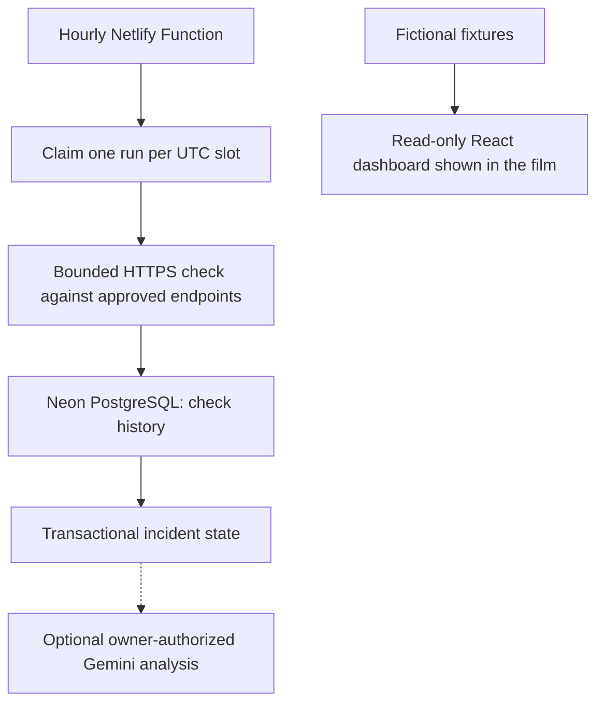

# Architecture overview

**SiteMedic · Designed & developed by Muhammad Bilal Siddiqui (MBS)**

## Monitoring and incident rules

- The server owns the list of exact targets. It validates network destinations,
  does not follow redirects, and reads only as far as response headers.
- Two consecutive observed failures open one incident. Two consecutive healthy
  checks resolve it. An unknown result interrupts either streak.
- Duplicate run evidence does not count twice. Late observations remain in
  history without rewriting the current state.
- The scheduler can work without Gemini or a dashboard. The showcased browser
  build is fictional; the hosted read API is not configured.

## Evidence in the public showcase

| Scene | What it proves | What it does not prove |
| --- | --- | --- |
| Scheduled run | One anonymized website and three test controls produced four persisted responses in the Nov. 21, 2026, 01:00 UTC slot | Current status; the 503 control was intentional |
| Archived checks | Real timestamps, HTTP 404 statuses and response times were recorded for a separate endpoint | Continuous downtime or an uptime percentage |
| Controlled recovery | An isolated `503 → 503 → 200 → 200` test exercised incident opening and resolution | Recovery of the archived endpoint |
| Saved Gemini report | One genuine, previously authorized analysis used a sanitized 20-check window | A confirmed root cause, log access, a live AI call, or automated remediation |

Verification for the reviewed showcase build: **348 Vitest tests**, **31 Playwright checks**
and **86.43% TypeScript line coverage**. Offline database tests exercised the
SQL without using real production history. These results are not a production SLA.

## Publication boundary

This package includes only documentation and reviewed media. It does not include
application source, runtime prompts, target addresses, deployment configuration,
private logs, connection strings, or access tokens. Nothing in this repository
can trigger checks, write monitoring evidence, or invoke Gemini.
