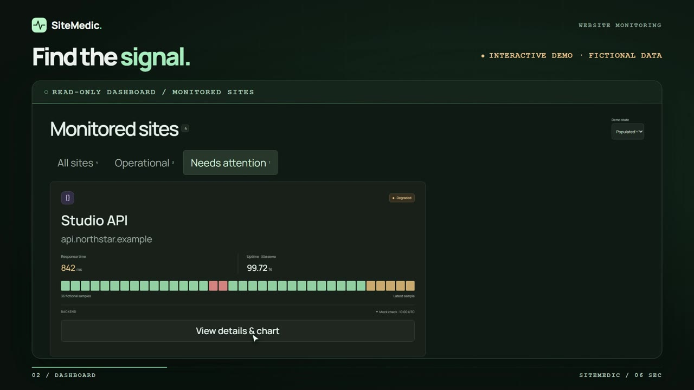
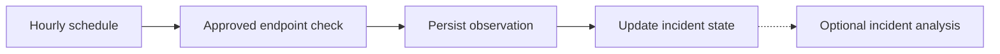
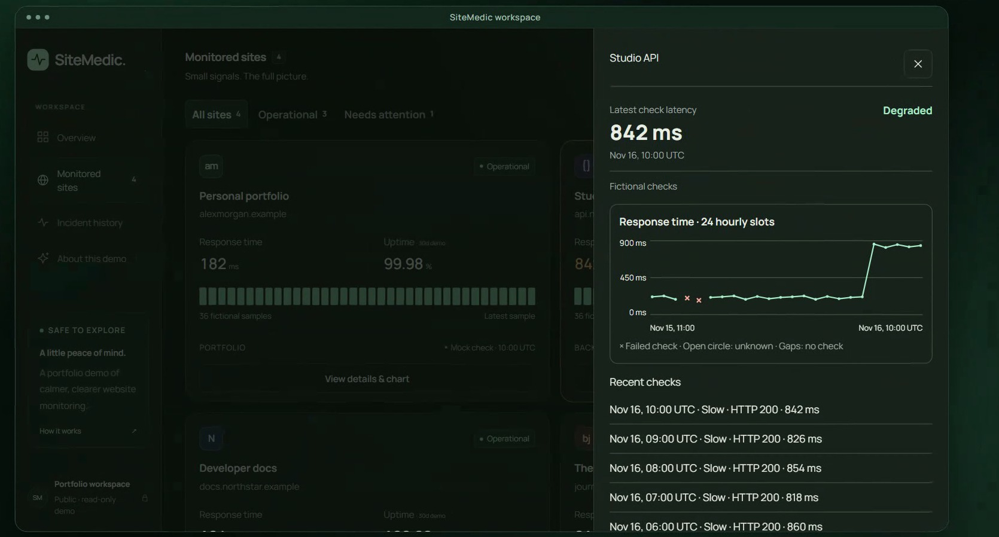
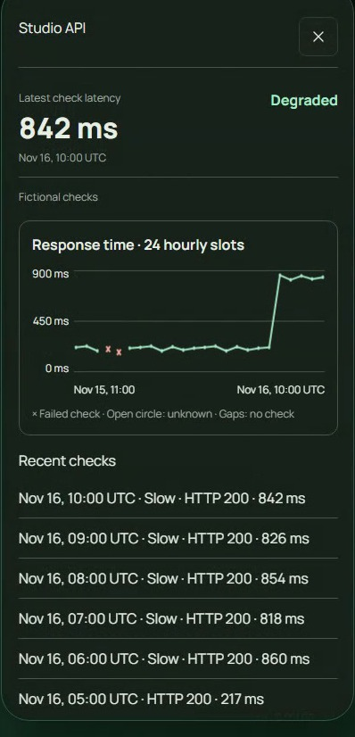

# SiteMedic — Website Monitoring

### Know when a site stops responding as expected.

**Designed & developed by Muhammad Bilal Siddiqui (MBS)**

[🌐 Explore the Interactive Demo](https://sitemedic-showcase.pages.dev/) · [🎬 Watch the Launch Film](https://sitemedic-showcase.pages.dev/#film) · [🏗️ Architecture](ARCHITECTURE.md) · [📸 Interface Gallery](#site-gallery)

---

## 💡 Overview

SiteMedic checks approved HTTPS endpoints on a schedule and keeps a record of
what responded, when, and how quickly. Repeated failures open an incident;
repeated healthy checks close it. The dashboard makes it easy to move from a
status summary to check history and incident details on desktop or mobile.

**[Explore the interactive demo](https://sitemedic-showcase.pages.dev/)** to
try the read-only dashboard with fictional data. The showcase separately
labels dated monitoring results, a controlled recovery test, and a saved
Gemini analysis. It does not show live monitoring status.

## 🎬 Product Showcase

**[▶ Watch the 30-second launch film in your browser](https://sitemedic-showcase.pages.dev/#film)**

30 seconds · 1920 × 1080 · 30 fps · H.264 video · AAC stereo audio (48 kHz) · on-screen text

The film shows the fictional dashboard, an isolated recovery test, and a saved
Gemini analysis of sanitized evidence. The showcase also presents dated monitoring
observations separately. Neither the film nor the showcase displays live status.

## ✨ Key Features

| Feature | What it does |
| --- | --- |
| ⏱️ Hourly checks | Checks a server-owned list of exact HTTPS endpoints |
| 📈 Check history | Records UTC timestamps, HTTP statuses, and response times; the chart leaves missing hours blank |
| 🚦 Incident tracking | Opens after two consecutive observed failures; resolves after two healthy checks |
| 🤖 Optional analysis | Suggests diagnostic next steps without claiming a root cause or executing a repair |
| 📱 Responsive dashboard | A side drawer on desktop, a full-screen details panel on phone widths, and reduced-motion support |

## 🔄 Monitoring Workflow

## 🛠️ Tech Stack

| Layer | Technologies |
| --- | --- |
| Interface | React, TypeScript, Vite, Tailwind CSS |
| Monitoring | Netlify Scheduled Functions, Node.js HTTPS |
| Persistence | Neon PostgreSQL, restricted roles, transactional incident updates |
| Optional incident analysis | Google Gemini AI, using sanitized check evidence |
| Verification | Vitest, PGlite, Playwright |

## 📸 Interface Gallery

| Desktop · Response-time drawer | Mobile · Site details |
| --- | --- |
|  |  |

## 🧠 Engineering Focus

- **Reliable incident history:** duplicate and late observations do not overwrite newer state. Unknown results break a streak without proving downtime.
- **Showcase build verification:** The reviewed application build passed 348 Vitest tests and 31 Playwright checks, with 86.43% TypeScript line coverage. Browser checks ran at 360, 390, 768, and 1280 CSS pixels. This case-study repository does not contain the source or test suites.

Seven development phases

1. Fictional, read-only dashboard
2. Bounded server-side HTTPS checker
3. Persistence and incident tracking
4. Optional incident analysis
5. Hourly scheduling
6. Security and regression checks
7. Mobile polish and portfolio showcase

## 🎓 Lessons Learned

- **Scheduler reliability:** A successful deploy does not prove a job ran. Verify that the packaged function loads and that a scheduled run writes the expected observations.
- **Least-privilege database access:** Separate scheduler, reader, and analysis roles so each can perform only its own operations.
- **SSRF prevention:** Keep exact HTTPS targets on a server-owned allowlist, reject private or local DNS answers, and disable redirects.
- **AI-independent monitoring:** Persist checks and update incidents without Gemini. Use optional analysis for hypotheses, not for alerting truth or automated repairs.

## 📌 Project Scope

This repository is a **public product case study and media showcase**, not the
application source or a live monitoring dashboard. The private deployment and
source repository are separate. Recorded observations are not an uptime
percentage, and the controlled test does not show recovery of a real website.

---

**Monitoring first. AI second.**

[GitHub Profile](https://github.com/M-Bilal-Sidd) · [Explore the Architecture](ARCHITECTURE.md)

