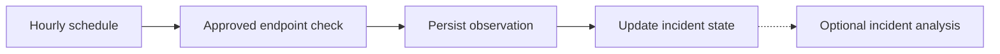

# SiteMedic — Website Monitoring

### Know when a site stops responding as expected.

**Designed & developed by Muhammad Bilal Siddiqui (MBS)**

[🎬 Watch the Showcase](media/sitemedic-launch.mp4) · [🏗️ Architecture](ARCHITECTURE.md) · [📸 Interface Gallery](#-interface-gallery)

---

## 💡 Overview

SiteMedic checks approved HTTPS endpoints on a schedule and keeps a record of
what responded, when, and how quickly. Repeated failures open an incident;
repeated healthy checks close it. The dashboard makes it easy to move from a
status summary to check history and incident details on desktop or mobile.

## 🎬 Product Showcase

**[▶ Watch / download the 60-second launch film](media/sitemedic-launch.mp4)**

1080p · H.264 · 60 fps delivery · original ambient score and on-screen captions · recorded from the actual interface

The film distinguishes fictional UI data, dated monitoring observations, an
isolated recovery test, and a saved Gemini analysis of sanitized evidence.
It was recorded before the portfolio launch; the closing access notice refers
to the private application source, not this case study.

## ✨ Key Features

| Feature | What it does |
| --- | --- |
| ⏱️ Hourly checks | Checks a server-owned list of exact HTTPS endpoints |
| 📈 Check history | Records UTC timestamps, HTTP statuses, and response times; the chart leaves missing hours blank |
| 🚦 Incident tracking | Opens after two consecutive observed failures; resolves after two healthy checks |
| 🤖 Optional analysis | Suggests diagnostic next steps without claiming a root cause or executing a repair |
| 📱 Responsive dashboard | A side drawer on desktop, a full-screen details panel on phone widths, and reduced-motion support |

## 🔄 Monitoring Workflow

## 🛠️ Tech Stack

| Layer | Technologies |
| --- | --- |
| Interface | React, TypeScript, Vite, Tailwind CSS |
| Monitoring | Netlify Scheduled Functions, Node.js HTTPS |
| Persistence | Neon PostgreSQL, restricted roles, transactional incident updates |
| Verification | Vitest, PGlite, Playwright |

## 📸 Interface Gallery

| Desktop · Response-time drawer | Mobile · Site details |
| --- | --- |
|  |  |

## 🧠 Engineering Focus

- **Bounded requests:** the browser cannot supply monitoring URLs or trigger a check. The scheduler uses approved targets and does not follow redirects.
- **Reliable incident history:** duplicate and late observations do not overwrite newer state. Unknown results break a streak without proving downtime.
- **Monitoring without AI:** the scheduler, persistence, and incident transitions run independently of Gemini.
- **Showcase build verification:** The application build shown in the film passed 348 Vitest tests and 31 Playwright checks, with 86.43% TypeScript line coverage. Browser checks ran at 360, 390, 768, and 1280 CSS pixels. This case-study repository does not contain the source or test suites.

Seven development phases

1. Fictional, read-only dashboard
2. Bounded server-side HTTPS checker
3. Persistence and incident tracking
4. Optional incident analysis
5. Hourly scheduling
6. Security and regression checks
7. Mobile polish and portfolio showcase

## 📌 Project Scope

This repository is a **public product case study and media showcase**, not the
application source or a live monitoring dashboard. The private deployment and
source repository are separate. Recorded observations are not an uptime
percentage, and the controlled test does not show recovery of a real website.

---

**Monitoring first. AI second.**

[GitHub Profile](https://github.com/M-Bilal-Sidd) · [Explore the Architecture](ARCHITECTURE.md)

